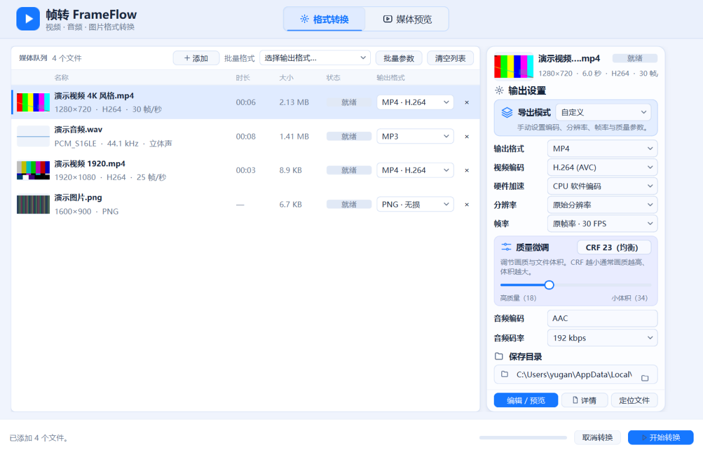
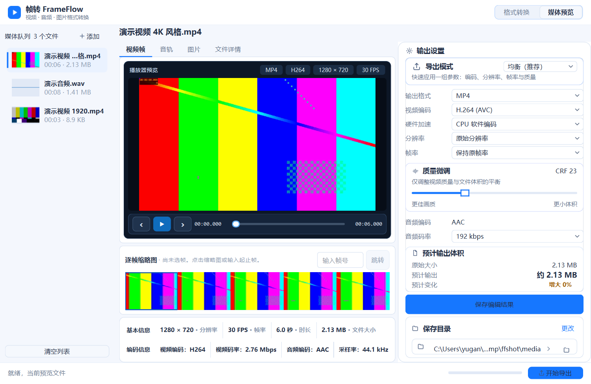
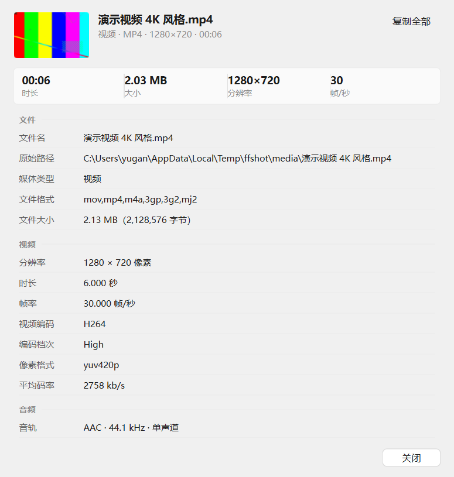

# 帧转 FrameFlow

基于 **Python + PySide6 + FFmpeg** 的 Windows 桌面媒体格式转换工具。原生窗口、原生控件，全部转换在本机通过 FFmpeg 命令行完成，不依赖浏览器、不上传任何文件。

> 三天限时 AI 工程笔试项目。开发过程、决策记录与测试报告都在仓库里，可对照查看。

## 项目特点

- **真正的桌面客户端**：PySide6（Qt 6）原生窗口，不是网页套壳，也没有内置浏览器
- **FFmpeg 命令行转换**：`ffmpeg` / `ffprobe` 由程序调用，输出参数（编码器、CRF、码率、缩放、帧率）逐项可调
- **媒体信息与缩略图**：导入即读容器、编码、分辨率、时长、码率、音轨信息，并生成缩略图
- **视频 / 音频 / 图片三类转换**，支持批量队列与任务进度
- **媒体预览**：视频逐帧浏览、音频波形、图片查看器，可导出当前帧或选中的视频片段

## 功能

### 媒体导入与队列
- 拖拽、文件对话框、命令行参数三种导入方式
- 队列显示缩略图、名称、时长、大小、状态、输出格式
- 重复路径自动去重；缺失文件在启动时提示

### 视频转换
- 容器：MP4 / MKV / MOV / WebM / AVI
- 编码：H.264 / H.265 / VP9 / MPEG-4；可选硬件加速（NVENC / AMF / QSV）
- 分辨率最长边、输出帧率、恒定质量（CRF 18–34）
- 视频 ↔ GIF（可限制体积）

### 音频转换与音频提取
- 格式：MP3 / M4A / WAV / FLAC / Opus / OGG
- 码率 96–320 kbps；WAV / FLAC 为无损，不提供有损质量滑块
- 视频可直接提取音轨（输出 MP3 等）

### 图片转换
- 格式：PNG / JPEG / WebP / AVIF / TIFF / BMP / GIF / ICO / PDF
- 有损格式提供 100%–40% 质量滑块；PNG 等无损格式只显示无损说明
- 按比例缩放最长边，不拉伸；RGBA 经 PNG / WebP 导出保留 Alpha，JPEG 以白底合成

### 预览
- 视频：播放/暂停、逐帧前进后退、时间轴点击定位、全屏、音量浮层
- 音频：波形绘制、选段、预览播放
- 图片：滚轮以光标为中心缩放（25%–600%）、放大后拖动、双击复位
- 文件详情：缩略图、速览指标、分组字段表，支持逐行复制

### 批量处理与进度
- 队列内逐行设置输出格式，或使用「批量格式」分类菜单统一设置
- 实时进度、速度与剩余时间；可随时取消，取消不残留临时文件

### 输出管理
- 单一「输出文件名」输入行 + 固定扩展名，导出后按该名称重命名
- 同名自动递增（`xxx (1).mp4`），不覆盖源文件与历史成品
- 保存目录可全局指定，缺省为源文件目录

## 界面截图

<table>
<tr>
<td></td>
<td></td>
</tr>
<tr>
<td align="center">格式转换主页</td>
<td align="center">媒体预览页（视频）</td>
</tr>
</table>



> 截图均为程序真实运行截图（离屏渲染，125% 缩放）。

## 技术栈

| 层 | 选型 |
|---|---|
| 语言 | Python 3.13 |
| GUI | PySide6 6.12（Qt Widgets，Fusion 风格 + 自定义 QSS） |
| 转码 | FFmpeg / FFprobe 9.0.2（命令行调用） |
| 位图处理 | Pillow 13.0 |
| 打包 | PyInstaller 6.22（onedir） |

## 安装与运行

### 方法 A：运行打包好的 Windows 版本（推荐）

1. 下载发行压缩包 `FrameFlow-Windows-x64.zip` 并解压到任意目录（路径可含中文，但不要放在只读位置）。
2. 双击解压目录里的 **`FrameFlow.exe`**。
3. 首次启动若 Windows 弹出 SmartScreen 提示，选择「更多信息 → 仍要运行」（程序未做代码签名）。

> 这是 **onedir** 结构：`FrameFlow.exe` 必须与同目录下的 `_internal/` 一起使用，**不能只复制 EXE**。整个目录可直接拷到 U 盘或其他机器运行，不需要安装 Python、PySide6、Pillow 或 FFmpeg。

### 方法 B：从源码运行

```powershell
git clone <仓库地址> FrameFlow
cd FrameFlow

py -3.13 -m venv .venv
.\.venv\Scripts\Activate.ps1
pip install -r requirements.txt
```

准备 FFmpeg / FFprobe（仓库不提交二进制，`.gitignore` 已排除 `bin/*.exe`）：

1. 到 <https://www.gyan.dev/ffmpeg/builds/> 下载 **ffmpeg-release-essentials**（约 80 MB）。
2. 解压后把其中的 `ffmpeg.exe` 与 `ffprobe.exe` 复制到项目的 `bin\` 目录。
3. 也可以不放进 `bin\`，改为把 FFmpeg 加入系统 `PATH`——程序会先用 `bin\`，找不到再查 `PATH`。

启动：

```powershell
.\.venv\Scripts\python.exe run.pyw
```

或双击仓库根目录的 `启动帧转.lnk`（指向本机 `.venv`）。

## 项目目录结构

```
FrameFlow/
├─ run.pyw                  # 程序入口（无控制台窗口）
├─ frameflow/
│  ├─ window.py             # 主窗口：队列、属性栏、批量转换、右键菜单
│  ├─ editor.py             # 编辑页：播放器、时间轴、波形、图片查看器、导出设置
│  ├─ media.py              # 媒体探测（ffprobe）、转换（ffmpeg）、图片编解码（Pillow）
│  ├─ editing.py            # 片段索引、剪切/拼接、预览渲染
│  ├─ playback.py           # 播放时钟与音轨调度
│  ├─ filmstrip.py          # 时间轴与逐帧缩略图
│  ├─ details.py            # 文件详情卡片与详情窗口
│  ├─ motion.py             # 自绘按钮、滑块、下拉、转场
│  ├─ theme.py              # 设计 token、QSS、调色板、图标
│  └─ icons.py              # 线框 SVG 图标
├─ tests/test_workflow.py   # 33 项自动化测试
├─ bin/                     # FFmpeg / FFprobe（不入库，见 bin/README.md）
├─ docs/                    # 截图与会话总结
├─ FrameFlow.spec           # PyInstaller 配置
├─ build_windows.bat        # 一键构建脚本
├─ requirements.txt
├─ README.md
├─ SESSION_SUMMARY.md       # 开发会话总结（决策与反馈）
└─ TEST_REPORT.md           # 测试报告
```

## 打包

```powershell
.\build_windows.bat
```

产物在 `dist\FrameFlow\FrameFlow.exe`。脚本会检查虚拟环境、按需安装 PyInstaller、调用 `FrameFlow.spec` 构建，并把 `bin\ffmpeg.exe`、`bin\ffprobe.exe` 一起收进 `_internal\bin\`。程序在冻结环境下通过 `sys._MEIPASS` 定位它们，因此发行目录可以整体移动。

发行 ZIP：`dist\FrameFlow-Windows-x64.zip`（约 120 MB，解压约 313 MB）。

## 测试情况

详见 [TEST_REPORT.md](TEST_REPORT.md)。

- **单元/集成测试**：33 项全部通过（`python -m unittest discover -s tests`）
- **真实 FFmpeg 转换**：已执行，覆盖 MP4→MKV/MOV/WebM、视频→GIF、WAV→MP3/FLAC、视频提取音频、PNG→JPEG/WebP/BMP/TIFF 等，输出用 FFprobe / Pillow 回读校验
- **GUI 自动化操作**：已执行，真实桌面窗口 + `QTest` 鼠标键盘事件，覆盖播放/暂停/逐帧/时间轴/全屏/音量浮层/图片缩放
- **PNG Alpha 回归**：RGBA、半透明、RGB 三种源图 → PNG/JPEG/WebP 六项断言通过；JPEG 白底合成符合预期
- **打包产物**：已在与源码无关的临时目录启动验证，媒体信息、缩略图、随包 FFmpeg 均正常

未验证项（如实列出）：人耳音画同步、全屏下的连续播放、批量转换逐行混合格式、磁盘不足/文件占用等极端情况、**在未安装 Python 的独立机器上的启动验证**。

## 已知限制

- 不兼容的编码/容器组合会让转换失败（例如把不支持的编码塞进容器），失败会在对应行显示原因，不中断其他任务
- 转换速度取决于源文件、编码器（软编/硬编）与机器性能；4K 或长视频耗时明显
- 部分格式依赖 FFmpeg 的编译选项（APNG、AV1 编码、x265 等），发行版 `ffmpeg-essentials` 已包含本项目校验过的常用编码器
- 硬件加速需要对应显卡驱动支持，不支持时需切回 CPU 编码
- 撤销/重做仅在编辑页当前会话内有效
- 界面按 125% 缩放调过；100% 缩放下信息密度偏松

## 开发记录

- [SESSION_SUMMARY.md](SESSION_SUMMARY.md)：开发会话总结，逐轮记录开发者反馈、决策与落地的改动
- [docs/session-2026-11-07.md](docs/session-2026-11-07.md)：面向外部读者的开发会话文档（含需求对照与复盘）
- [TEST_REPORT.md](TEST_REPORT.md)：单元测试、真实转换、GUI 自动化与打包验收记录

## 许可证

本项目**未添加 LICENSE 文件**，因此不声明任何开源授权；默认保留所有权利。如需开源，请仓库所有者自行选择并添加许可证。
