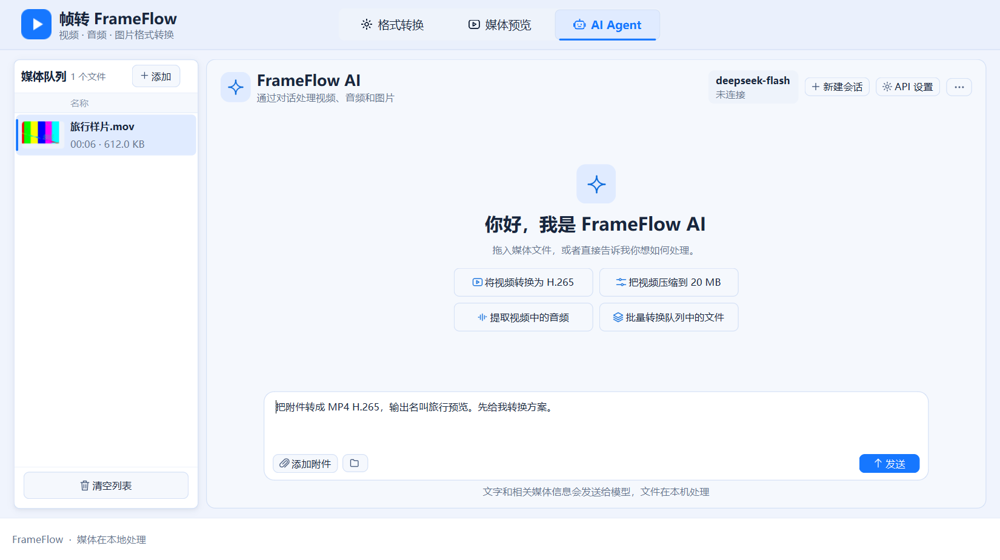
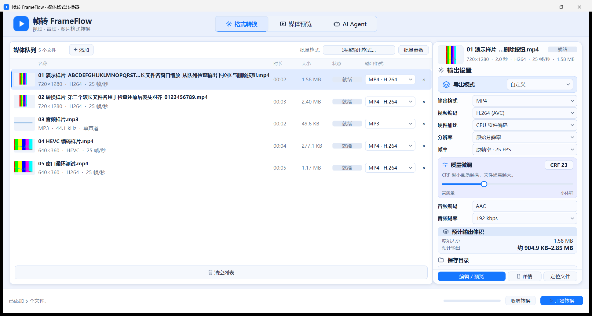

# 帧转 FrameFlow

**FrameFlow（帧转）是集媒体转换、逐帧编辑与 AI Agent 操作为一体的 Windows 桌面应用。** 拖入视频、音频或图片即可查看缩略图和媒体信息。也可以用自然语言设置批量转换，核对计划后再执行。

项目起于三天限时的 AI 桌面端笔试，之后扩展为三个工作区。客户端使用 PySide6 Widgets，媒体处理通过 FFmpeg、FFprobe 和 Pillow 在本机完成。AI Agent 连接用户配置的云端模型，需要网络和自己的 API Key。

[下载 v1.2.4 安装版（Windows x64）](https://github.com/yuganwinfurt-bot/FrameFlow/releases/download/v1.2.4/FrameFlow-Setup-v1.2.4-Windows-x64.exe) · [下载 ZIP 便携版](https://github.com/yuganwinfurt-bot/FrameFlow/releases/download/v1.2.4/FrameFlow-Windows-x64.zip) · [Agent 使用指南](docs/ai-agent.md) · [测试报告](TEST_REPORT.md)

## 下载和试用

| 版本 | 下载 | 启动方式 |
| --- | --- | --- |
| **EXE 安装版（推荐）** | [v1.2.4 安装包](https://github.com/yuganwinfurt-bot/FrameFlow/releases/download/v1.2.4/FrameFlow-Setup-v1.2.4-Windows-x64.exe) | 双击进入中文安装向导，可选择安装目录和桌面快捷方式。从开始菜单启动，可在系统设置卸载 |
| 便携 ZIP | [v1.2.4 便携包](https://github.com/yuganwinfurt-bot/FrameFlow/releases/download/v1.2.4/FrameFlow-Windows-x64.zip) | 完整解压后双击 `FrameFlow.exe`，保留同目录的 `_internal` 文件夹 |

两种发行包来自同一次 Windows x64 构建，内置 Python、PySide6、Pillow 和 FFmpeg/FFprobe。媒体预览、编辑与转换可离线使用。已安装的用户可退出 FrameFlow，再运行新版安装包沿用安装位置。便携用户可把新版完整解压到独立目录。 [发行说明与校验值](https://github.com/yuganwinfurt-bot/FrameFlow/releases/tag/v1.2.4) · [全部发行版本](https://github.com/yuganwinfurt-bot/FrameFlow/releases)

### v1.2.4 修复

窗口还原后再次最大化，媒体队列表头和文件行按实际视口重新对齐，输出格式下拉框和删除按钮保持完整可见。 [Windows 验收](TEST_REPORT.md#v124-queue-resize-acceptance)

### v1.2.3 修复

AI Agent 聊天气泡按实际文本排版计算尺寸。短消息保持单行，手动换行保留，长消息随窗口宽度自动换行。 [Windows 验收](TEST_REPORT.md#v123-bubble-acceptance)

### v1.2.2 修复

预计体积按当前导出内容更新。视频使用编辑后时长与编码参数给出粗估范围，音频按输出时长和码率或 PCM 参数计算，单帧图片在后台试编码。信息不足时显示「无法准确预估」。 [源码与发行包验收](TEST_REPORT.md#v122-size-estimate-acceptance)

### v1.2.1 修复

「格式转换」和「媒体预览」的默认视频分辨率显示为「原始分辨率」，默认导出保留源尺寸。Windows 拒绝写入输出目录时，转换任务会报告失败并结束。 [修复和复测记录](TEST_REPORT.md#v121-resolution-acceptance)

### v1.2.0 更新

- **AI Agent 工作区**支持 13 个工具，可读取素材、调整输出参数、生成转换方案、查询进度和取消 Agent 发起的转换。
- **三个工作区连续转场**共享素材队列，预览状态和本次会话随切页保留。
- **拖拽和时间轴编辑**支持队列弹簧排序、右键移动帧、拖入素材时的插入指示线、拖拽滚动和边缘自动滚动。
- **滚轮操作**可浏览设置面板，悬停在播放音量、视频质量或时间轴缩放滑块上时可直接调节。

试用时，先拖入一个 MP4 文件，选中队列里的素材，在右侧设置输出格式和目录。点「开始转换」，完成后点「打开成品」。切到「媒体预览」可以逐帧查看并保存当前帧。

## AI Agent 快速试用

进入「AI Agent → API 设置」，选择支持 Chat Completions 工具调用的模型服务，填写自己的 API Key 并测试连接。把素材拖入聊天区后，可以说「把附件转成 MP4 H.265，输出名叫项目预览，先给我转换方案」。在桌面计划卡中核对文件和路径，点「确认执行」后才会启动 FFmpeg。

应用会向模型服务发送对话和工具所需的素材名称与媒体信息。媒体文件由本机处理。可用输出目录来自源目录、已有设置或用户选择的目录。 [13 个工具、模型设置与权限说明](docs/ai-agent.md)

## 界面截图



<table>
<tr>
<td></td>
<td></td>
</tr>
<tr>
<td align="center">格式转换</td>
<td align="center">媒体预览与逐帧编辑</td>
</tr>
</table>

<details>
<summary>查看文件详情界面</summary>


</details>

## 主要功能

| 场景 | 支持的操作 |
| --- | --- |
| 导入与管理 | 拖放或选择本地文件，后台读取缩略图和媒体信息。队列按文件保存输出设置并显示进度和失败原因 |
| 视频转换 | 输出 MP4、MKV、MOV、WebM、AVI 或 GIF。可调整分辨率、帧率、质量、音频码率和目标体积。部分编码器可用硬件加速，失败时回退软件编码 |
| 预览与编辑 | 播放、全屏、音量、逐帧浏览、时间线选段。支持音视频联动裁剪、波形选段和单帧导出 |
| 音频与图片 | 提取视频音轨，转换 MP3、M4A、WAV、FLAC、Opus、OGG。图片支持 PNG、JPEG、WebP、AVIF、TIFF、BMP、GIF、ICO、PDF |
| 成品管理 | 选择保存目录、取消转换、打开成品。同名输出自动加序号，保留源文件和已有成品 |
| AI Agent | 通过自然语言读取媒体信息、设置格式和质量、选择已授权输出目录、生成转换计划并查看结果 |

实际可用的硬件编码选项取决于 FFmpeg 构建、显卡与驱动。目标体积是编码目标，成品大小取决于素材与编码器。

## 客户端实现

| 模块 | 职责 |
| --- | --- |
| [启动入口](run.pyw) | 创建 Qt 应用，定位随包的媒体工具，启动主窗口 |
| [窗口与队列](frameflow/window.py) | Qt 主线程更新界面，后台线程探测媒体和处理批量任务。每个素材保存独立的导出参数 |
| [媒体处理](frameflow/media.py) | FFprobe 读取元数据，FFmpeg 生成缩略图、转码并回传进度。`Processes` 管理子进程取消，成品从临时文件发布 |
| [编辑与播放](frameflow/editor.py) · [片段渲染](frameflow/editing.py) · [播放调度](frameflow/playback.py) | 逐帧预览按需解码。剪切与粘贴更新片段引用，预览和导出按同一时间线渲染 |
| [Agent 会话](frameflow/agent.py) · [模型连接](frameflow/agent_api.py) | Qt 通过异步网络请求收发 Chat Completions 消息和工具调用。Windows 使用当前用户的 DPAPI 保存凭据 |
| [工具与确认](frameflow/agent_tools.py) | 根据队列 ID 和目录权限校验工具参数。用户确认计划后，将任务参数快照提交给原有 FFmpeg 转换队列 |
| [工作流测试](tests/test_workflow.py) | 覆盖真实导出、参数隔离、异步定位、音视频联动、取消与同名保护 |

一个实际问题是，实拍视频有 **6.76 秒**，音轨约 **6.18 秒**就结束，选择多段帧时预览会卡在准备阶段。修复后，渲染按每段时长建立静音底轨，再叠加实际音频。用原来的四段选区复测，共 **34 帧**，成功播放到最后一帧。 [复现与回归记录](SESSION_SUMMARY.md) · [音轨渲染代码](frameflow/editing.py)

## 我怎样用 AI 开发和验收

我确定客户端选型，用截图和实际操作给 AI 划定修改范围，再根据运行结果决定接受、继续修改或停止。比如，我要求同一文件设为 **H.265、720P、CRF 23** 后，切换转换页和预览页仍保留参数。实现复用了导出参数模型，回归用例同时检查了两页同步和不同文件之间的参数隔离。 [AI 开发会话总结](FrameFlow_开发会话总结_2026-11-08.md) · [参数回归用例](tests/test_workflow.py#L824)

- [功能演进记录](SESSION_SUMMARY.md)｜需求变更、技术方案与阶段验证。
- [界面改版记录](docs/session-2026-11-07.md)｜参考图、用户反馈、界面取舍与回归。
- v1.1.0 的便携、安装、覆盖升级和卸载验收，以及后续 Agent 开发分支的 124 项通过记录均有保留。 [历史测试报告](TEST_REPORT.md)
- v1.2.0 的源码回归、真实模型验收、Windows 包测试和两种附件校验值见本次发行记录。 [源码验收](TEST_REPORT.md#v120-release-acceptance) · [发行包验收](https://github.com/yuganwinfurt-bot/FrameFlow/releases/tag/v1.2.0)

独立无 Python 的干净机器和人耳判断声画同步仍待验证。 [验收记录](TEST_REPORT.md)

## 从源码运行

AI Agent 工作区支持通过云端模型调用队列和转换工具。配置方式、目录授权和确认流程见 [AI Agent 使用说明](docs/ai-agent.md)。

```powershell
git clone https://github.com/yuganwinfurt-bot/FrameFlow.git
cd FrameFlow
py -3.13 -m venv .venv
.\.venv\Scripts\python.exe -m pip install -r requirements.txt
```

把 `ffmpeg.exe` 和 `ffprobe.exe` 放入 `bin`，或添加到 `PATH`。配置完成后运行下方命令启动应用。 [媒体工具配置说明](bin/README.md)

```powershell
.\.venv\Scripts\python.exe run.pyw
```

用下面的命令运行工作流测试。

```powershell
.\.venv\Scripts\python.exe -m unittest discover -s tests -v
```

如需构建 Windows 运行目录，可运行 `.\build_windows.bat`。生成 ZIP 和安装包时，使用 64 位 Python 环境中的 PyInstaller 和 NSIS 3.13，在干净的源码提交上运行以下命令。指定的输出目录应尚未创建。

```powershell
.\.venv\Scripts\python.exe .\packaging\package_windows.py --makensis "C:\path\to\makensis.exe" --output .\dist\release
```

脚本生成两个发行包及 `BUILD_INFO.txt`，记录构建提交、工具版本、文件大小和 SHA-256。 [PyInstaller 配置](FrameFlow.spec) · [NSIS 安装脚本](packaging/FrameFlow.nsi)

## 许可证

FrameFlow 源码目前未附开源许可证。随包分发的 FFmpeg 等第三方组件遵循各自的许可证，见发行目录中的 `ThirdParty`。
